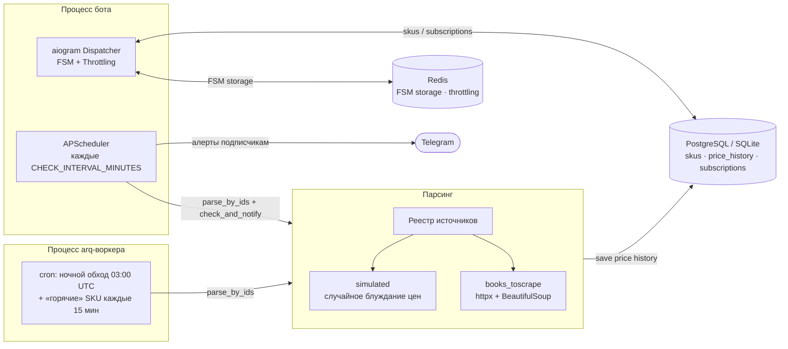
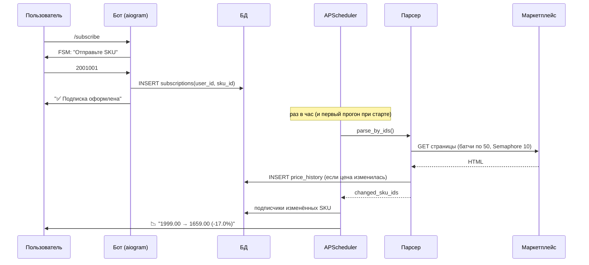

# 📈 PriceRadar

Асинхронный сервис мониторинга цен конкурентов: фоновый воркер периодически обходит
SKU, пишет историю цен в БД и автоматически присылает Telegram-алерты подписчикам,
когда цена изменилась или товар пропал из наличия.

> Пет-проект, демонстрирующий production-подходы: FSM, ретраи с экспоненциальным
> backoff, батчевый обход с ограничением параллельности, фоновые задачи,
> Docker-контейнеризация.

---

## Архитектура



**Два фоновых контура:**

| Контур | Где живёт | Что делает |
|---|---|---|
| APScheduler | процесс бота | раз в час (`/check` — вручную): парсинг активных SKU → детект изменений → Telegram-алерты подписчикам. Первый прогон — сразу после старта |
| arq + cron | отдельный контейнер | тяжёлый полный обход в 03:00 UTC и «горячих» SKU каждые 15 минут |

Дедупликация цен работает на обоих контурах: строка в `price_history` пишется
только если цена изменилась, поэтому двойной парсинг не порождает алертов-дублей.

## Стек

- **Python 3.11+, asyncio** — единый асинхронный рантайм
- **aiogram 3.x** — бот: Routers, FSM (`RedisStorage` / `MemoryStorage`), middleware
- **APScheduler 3.x** — периодические проверки в процессе бота
- **arq + Redis** — тяжёлые cron-обходы в отдельном воркере
- **SQLAlchemy 2.0 (async)** + `asyncpg` (PostgreSQL 15) / `aiosqlite` (SQLite)
- **httpx + BeautifulSoup4 (lxml)** — HTTP-клиент и разбор HTML
- **Docker / docker-compose** — 4 контейнера с healthchecks

## Структура

```
priceradar/
├── app/
│   ├── config.py                # pydantic-settings, вся конфигурация через .env
│   ├── worker.py                # arq WorkerSettings: cron 03:00 + каждые 15 мин
│   ├── db/
│   │   ├── engine.py            # async engine (SQLite/PostgreSQL) + session_factory
│   │   ├── models.py            # skus / price_history / subscriptions
│   │   ├── init_db.py           # create_all + частичный уникальный индекс
│   │   └── seed_demo.py         # демо-SKU: 3 реальных + 3 симулированных
│   ├── parser/
│   │   ├── http_client.py       # backoff на 429/5xx, Retry-After, ротация User-Agent
│   │   ├── runner.py            # батчи по 50, Semaphore(10), дедуп цен
│   │   └── sources/
│   │       ├── registry.py      # name -> fetch_price()
│   │       ├── books_toscrape.py# реальный сайт, BeautifulSoup
│   │       └── simulated.py     # симуляция цен для демо
│   ├── services/
│   │   └── monitor.py           # check_and_notify(): парсинг -> изменения -> алерты
│   └── bot/
│       ├── main.py              # Dispatcher + APScheduler + storage
│       ├── handlers.py          # /start /subscribe /unsubscribe /subscriptions /check
│       └── middlewares.py       # ThrottlingMiddleware (anti-spam через Redis)
├── docker-compose.yml           # bot / parser-worker / postgres:15 / redis:7
├── Dockerfile
├── requirements.txt
├── .env.example                 # шаблон конфигурации (коммитится в репозиторий)
└── .env                         # реальный конфиг (в .gitignore, не коммитится)
```

## Схема работы бота



## Быстрый старт (Docker)

```bash
cp .env.example .env
# впишите BOT_TOKEN от @BotFather в .env

docker compose up -d --build

# схема БД (однократно)
docker compose run --rm parser-worker python -m app.db.init_db

# демо-товары (однократно)
docker compose run --rm parser-worker python -m app.db.seed_demo

docker compose ps        # все 4 сервиса Up
docker compose logs -f parser-worker
```

После старта бот сам запускает первую проверку (исключительно для удобства
демонстрации), затем повторяет её раз в час. В Telegram:

```
/start → /subscribe → 2001001 → /check
```

`/check` покажет сводку прогона, а на симулированных SKU придут алерты
о «распродажах» — полный цикл виден вживую, без ожидания часа.

## Быстрый старт (локально, без Docker)

Локальный режим минимально требователен: SQLite по умолчанию, Redis не нужен
(FSM в памяти, throttling отключается автоматически).

```bash
python -m venv .venv
.venv\Scripts\activate        # Windows; на Linux/macOS: source .venv/bin/activate
pip install -r requirements.txt

cp .env.example .env          # вписать BOT_TOKEN

python -m app.db.init_db
python -m app.db.seed_demo
python -m app.bot.main
```

## Конфигурация (.env)

| Переменная | По умолчанию | Описание |
|---|---|---|
| `BOT_TOKEN` | — | токен от @BotFather (обязателен для бота) |
| `DB_DSN` | `sqlite+aiosqlite:///./priceradar.db` | DSN БД; в docker-compose переопределяется на PostgreSQL |
| `REDIS_DSN` | *(пусто)* | Redis для FSM/throttling; пусто → in-memory |
| `CHECK_INTERVAL_MINUTES` | `60` | период проверок APScheduler |
| `PARSE_BATCH_SIZE` | `50` | размер батча SKU |
| `PARSE_CONCURRENCY` | `10` | параллельные HTTP-запросы (Semaphore) |
| `THROTTLE_RATE` / `THROTTLE_WINDOW_S` | `3` / `2` | анти-спам (нужен Redis) |

`.env` не коммитится (`.gitignore`); шаблон `.env.example` — в репозитории.

## Источники цен

Добавление нового источника — две строки в реестре:

1. `app/parser/sources/<name>.py` — функция с сигнатурой
   `async def fetch_price(client, sku, last_price) -> ParsedPrice` (httpx/BS4,
   backoff переиспользуется из `http_client.fetch_page`);
2. запись в `PARSERS` в `app/parser/sources/registry.py`.

Из коробки:

| Источник | Что делает |
|---|---|
| `simulated` | случайное блуждание ±3%, 15% шанс «распродажи» (-5..-20%) — работает без сети |
| `books_toscrape` | реальный HTTP-парсинг [books.toscrape.com](http://books.toscrape.com) (песочница для скрейпинга, без anti-bot) |

## Метрики для наблюдения

- `docker compose logs -f bot` — `scheduled check done: total=..., changed=..., notified=...`
- `docker compose logs -f parser-worker` — `parse run: N SKUs, batch=50, concurrency=10`
- SQL: `SELECT * FROM price_history ORDER BY collected_at DESC LIMIT 20;`

## Roadmap

- Alembic-миграции вместо `create_all`
- Приоритетные очереди arq (`high/default`) для срочных SKU
- REST API (FastAPI) и веб-дашборд (Next.js + Tailwind)
- Прокси-пул и Playwright для маркетплейсов с anti-bot
- CI (GitHub Actions): ruff, mypy, pytest

## License

MIT
